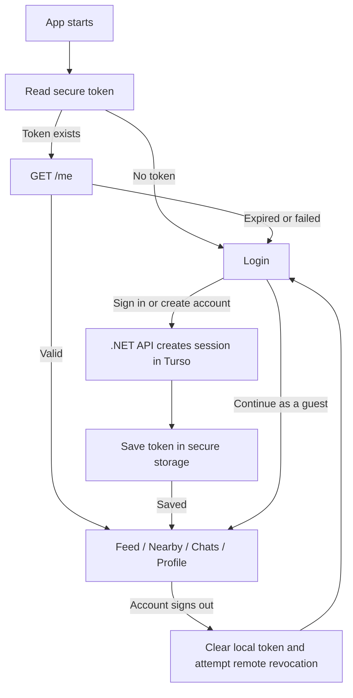

# UI and authentication guide

This guide describes the authentication and feed modules developed on `auth` and `feed` and integrated into `main`. The project owner confirmed authentication working on the connected phone on **2026-10-24**. Login, registration, session restoration, and guests enter the module tabs directly; the welcome screen has been removed.

## Authentication views

| View | Content and actions | Result and states |
| --- | --- | --- |
| Startup | Loading indicator while checking the saved session. | A valid session opens Feed. No session or a failed check opens Login; connection/storage failures show a startup message. |
| Login | Email, password, show/hide password, **Remember my email**, **Sign in**, **Create account**, **Continue as a guest**. | Sign-in opens Feed. Invalid fields show validation; service errors appear in the form. Submitting disables controls and shows progress to prevent duplicate requests. |
| Create account | Name, email, password, confirmation, visibility toggle, submit, and Back. | Registration also signs in and opens Feed. Errors appear in the form. Submission disables controls and prevents Back until the request finishes. |
| Profile: account | Avatar icon, current user's name/email, and **Sign out**. | Sign out returns to Login. A device storage failure shows a snackbar and keeps the account signed in. Profile editing remains planned. |
| Profile: guest | Guest explanation and **Sign in**. | Sign in returns to Login. Guest access creates no account or session. Android Back from the guest shell also returns to Login. |
| Module tabs | Feed, Nearby, Chats, and Profile. | Feed opens first. `IndexedStack` preserves tab state while switching in the current shell. Feed, Nearby, and Chats remain starting screens on this branch. |

### Layout and validation

- Login uses the existing navy/yellow colors and Urbanist typography. Small screens use tighter spacing; wide screens place the welcome text beside the form. Forms scroll for the keyboard, validation messages, and enlarged text.
- Login's fixed `SafeArea` footer keeps **Create account** and **Continue as a guest** above Android's navigation controls. It hides while the keyboard is open.
- Fields support autofill and keyboard Next/Done actions. Login requires a valid email and nonempty password. Email is trimmed before submission; passwords are preserved exactly.
- Registration requires a trimmed name of 2–80 characters, a valid email of at most 254 characters, a password of 8–128 characters, and matching confirmation. Confirmation stays on the device. Its visibility toggle controls both password fields.
- Connectly does not load a saved password from Hive. Successful authentication completes the platform autofill context; the device's password manager can independently offer to save credentials.

## Authentication functions

| Component | Functions / responsibility | Source |
| --- | --- | --- |
| Startup | Opens Hive preferences, creates the API/session controller, and starts restoration. Hive initialization failure leaves authentication usable with email remembering disabled. | [main.dart](lib/main.dart) |
| Gate | Observes the controller and chooses loading, Login, or `AppShell`. Pushes registration and guest routes. | [AuthGate](lib/features/auth/presentation/auth_gate.dart) |
| Login | `_submit()` validates, saves the email preference, and calls sign-in. `_continueAsGuest()` saves the preference and opens tabs. `_saveEmail()` manages remembering/deletion. | [LoginScreen](lib/features/auth/presentation/login_screen.dart) |
| Registration | Validates the form, calls sign-up, and closes the registration route after success. | [SignupScreen](lib/features/auth/presentation/signup_screen.dart) |
| Account state | `signIn()` / `signUp()` obtain a session; `_accept()` securely saves its token before exposing the user. `restore()` validates saved credentials; `signOut()` clears them and attempts server revocation. | [AuthController](lib/features/auth/application/auth_controller.dart) |
| HTTP repository | `signIn`, `signUp`, `currentUser`, and `signOut` send JSON, attach bearer credentials when required, and map failures to `AuthException`. | [AuthApi](lib/features/auth/data/auth_api.dart) |
| Contracts | `AuthUser`: ID, name, email, creation date. `AuthSession`: user and token. `AuthRepository`: four account operations. | [Auth models](lib/features/auth/domain/auth_models.dart) |
| Shared profile | `AuthScope` exposes the controller. Profile reads its in-memory user and invokes sign-out; opening the tab does not call `/me` again. | [AuthScope](lib/features/auth/presentation/auth_scope.dart), [ProfileScreen](lib/features/auth/presentation/profile_screen.dart) |
| Server service | Normalizes emails, hashes/verifies passwords, creates accounts/sessions, retrieves users, and revokes sessions. | [AuthService.cs](backend/Services/AuthService.cs) |

### Request flow

| Operation | API | Server behavior |
| --- | --- | --- |
| Register | `POST /auth/signup`: name, email, password | Creates user and session in one transaction; returns 201 with `user`, `token`, `expiresAt`. |
| Sign in | `POST /auth/login`: email, password | Verifies the password and creates a session; returns 200 with the same session fields. |
| Restore | `GET /me` with bearer token | Checks the session hash and expiry in Turso; returns `{ user }`, or 401 for an invalid session. |
| Sign out | `POST /auth/logout` with bearer token | Deletes that session and returns 204. Other device sessions remain valid. |

The backend trims/lowercases emails and uses ASP.NET Core Identity's salted password hasher. Unknown accounts and incorrect passwords return the same 401 message. Duplicate email returns 409, invalid input 400, rate limiting 429, and unexpected service failures a safe 503 response. Login/signup share a limit of 30 attempts per IP per 15 minutes. See [backend/README.md](backend/README.md) for setup and endpoint details.

## Authentication storage and cache

These are the stores implemented today. Hive does not yet contain profile, feed, or chat caches.

| Store | Data / key | Write and read behavior | Lifetime / clearing |
| --- | --- | --- | --- |
| Hive | `Box<String>('auth_preferences')`, key `remembered_email`; optional email only. | Login loads it when created. Login submission or guest entry saves a valid trimmed email when opted in. | Survives restart/logout. Unchecking deletes it immediately; saving with no valid opted-in email also deletes it. No TTL or sync. |
| Platform secure storage | Key `connectly_auth_session`; opaque user bearer token only. | Saved after login/signup; read at startup before `/me`. | Cleared on logout or a 401 during restoration. Server validity is seven days. Flutter does not store or schedule renewal from `expiresAt`. |
| Controller memory | Current user, token, restoring flag, startup message. | Account data comes from authentication or `/me`. | User/token clear on logout or failed restoration. Process termination discards memory; no persistent profile cache. |
| Navigation memory | Selected tab and mounted widgets in `IndexedStack`. | Updated within the current shell. | Not persisted. A fresh shell starts on Feed. |
| Turso `users` | ID, normalized unique email, name, password hash, creation timestamp. | Created by registration; read through the API. | Survives device logout. Account deletion is not implemented. |
| Turso `auth_sessions` | SHA-256 token hash, user ID, creation/expiry timestamps. | A new session is created for each signup/login. | Fixed seven-day expiry; logout deletes the current session. No refresh/sliding renewal or automatic expired-row cleanup. |
| Backend configuration | Ignored root `dbtoken` file supplies the Turso database credential locally. | Read by the backend; .NET configuration can override it. | Separate from user tokens; never delivered to Flutter or stored in Hive. |

Implementations: [HiveLoginPreferences](lib/features/auth/data/login_preferences.dart), [SecureAuthSessionStore](lib/features/auth/data/auth_session_store.dart), and [Turso auth schema](backend/migrations/001_auth.sql).

### Remembered email lifecycle

**Remember my email** is independent of authentication. Checking alone does not write; submitting Login or entering as a guest does. The preference is saved before the sign-in request, so the email may remain even if the password is incorrect. Registration does not independently save this preference.

Passwords and session tokens are never written to Hive. Preference write failures show an availability notice and do not block sign-in or guest access. Logout retains the remembered email to prefill Login; uncheck the option to remove it.

### Session and offline lifecycle

1. Startup reads secure storage. No token means Login; an existing token requires a successful `/me` response before authenticated access is restored.
2. A 401 clears the token and returns to Login. If deletion fails, a startup message asks the user to sign in again.
3. A network/service failure returns to Login with a reconnect message, retaining the secure token for a later startup attempt. A stored token alone does not grant offline authenticated access; guest navigation remains available.
4. If saving a newly issued token fails, the controller rejects local sign-in, attempts remote revocation, and reports a storage error. Registration may already have created the account; the user can subsequently sign in to it.
5. Logout first deletes the device token, then clears the in-memory account and attempts remote revocation. If the network is unavailable, local logout succeeds and the remote session remains valid until expiry or explicit revocation. Revocation is not queued for retry. If local deletion fails, logout stops and Profile shows an error.

`AuthApi` implements no HTTP response cache; the backend sends `Cache-Control: no-store`. Automatic Hive/Turso sync, background refresh, token refresh, persistent profile caching, and offline authenticated restoration are not implemented. An already open account remains in memory until logout or process termination; there is no periodic `/me` check or automatic navigation at expiry. Protected API requests still require server session validation.

## Verification

The last code verification before this documentation update reported **17 passing Flutter tests**, no analyzer issues, a successful .NET build, and a passing live Turso authentication integration check. The owner subsequently confirmed authentication working on the phone. This documentation update changes no runtime behavior.

| Check | Coverage / source |
| --- | --- |
| API client | Request bodies, preserved passwords, bearer headers, service errors: [auth_api_test.dart](test/features/auth/auth_api_test.dart). |
| Controller | Secure save before accepting a user, restoration, expired/offline sessions, save failure revocation, local logout: [auth_controller_test.dart](test/features/auth/auth_controller_test.dart). |
| Hive | Write, close/reopen, and delete the preference: [login_preferences_test.dart](test/features/auth/login_preferences_test.dart). |
| Login widgets | Validation, preference, visibility, busy/errors, guest navigation, small screens/keyboard, system navigation spacing: [login_screen_test.dart](test/features/auth/login_screen_test.dart). |
| Real API/database | Registration, login, authorization, hashes, duplicates, rollback, logout, expiry: [Test-Authentication.ps1](backend/tests/Test-Authentication.ps1). |

For a phone regression check: create an account, inspect Profile, restart with the API reachable to restore the session, sign out, sign in again, and check remembered email and guest navigation independently. Restarting with the API unavailable should show Login with a reconnect message rather than an authenticated cached profile.

## Feed views on `feed`

The `feed` branch includes the authentication baseline. Its Feed tab now loads real posts from the .NET API and Turso. See the [feed module guide](lib/features/feed/README.md) for source functions, storage, and verification, and the [API route reference](backend/README.md#feed-and-connections-on-feed).

| View | Actions and states |
| --- | --- |
| Feed | Navy/yellow styling, greeting, composer card, Connections/Friends/Following chips, newest-first post cards, author/name/time, reaction totals, and People button. Own posts appear in every filter. Pull down to refresh; Load more fetches the next 20. Empty/error/loading states are explicit. |
| Create post | Opens a keyboard-aware scrolling sheet with author, text field/counter, Share post, and Close. Whitespace-only posts cannot submit. Publishing prevents duplicate requests and dismissal; failure retains text for retry. Success inserts the returned post at the top. Closing discards the in-memory draft. |
| Post | React opens Like/Love/Celebrate/Insightful choices, plus Remove reaction when selected. Server counts are authoritative. Only your own posts show Delete; confirmation precedes removal. There are no comment controls. |
| People | Search registered users by name, Discover/Requests chips, Follow/Following, Add friend, Accept/Decline, Cancel request, and friend removal. Connection controls disable while updating; failures show an error. Returning refreshes Feed. |
| Guest Feed | Sign-in invitation; it does not request private feed data or allow publishing/reactions/connections. |

Friends require recipient acceptance; follows are one-way and independent. Pending requests grant no feed access. Feed/People data and drafts are held in memory, with no Hive cache or automatic refresh. Other users' changes appear on refresh. Startup authentication still requires `/me`, as documented above. Images, post editing, comments, and advanced ranking remain planned.

## Navigation shell: `lib/app/app_shell.dart`

`NavigationBar` has Feed, Nearby, Chats, and Profile destinations. `IndexedStack` keeps tab state while switching. Each destination loads one `module_entry.dart` file. A feature branch replaces its own entry's placeholder with its screen; no other feature file needs editing. The shell owns navigation only and makes no API calls.

## Empty module screen: `lib/shared/presentation/module_placeholder_screen.dart`

The four tabs on the original `main` baseline show a titled `Scaffold` and an `EmptyState` with an icon and message. On `auth`, Profile is implemented as described above; the other modules remain starting views. Real loading, empty-response, and service-error states belong to each future feature implementation.

## Shared components

- `EmptyState` centers an icon, title, and message with a maximum width. It can later represent a real empty response; loading and error states need separate UI.
- `ConnectlyTheme` supplies the dark navy and yellow app colors and styles the navigation bar.
- `ConnectlyApp` creates `MaterialApp` and supplies `AuthScope` to all routes. On `auth`, its gate restores a validated account or opens Login. `main.dart` initializes Hive preferences, creates the API/session controller, and starts session restoration.

For each future screen, document its widgets, actions, navigation, Hive values or cloud records, and loading, empty, and error states here. Feature repositories own data access. Include persistence and account/guest behavior when documenting a completed flow. A visual control should have real behavior before being presented as a working feature.

Remaining authentication work includes profile editing, password recovery, and the planned face verification/liveness demonstration.
